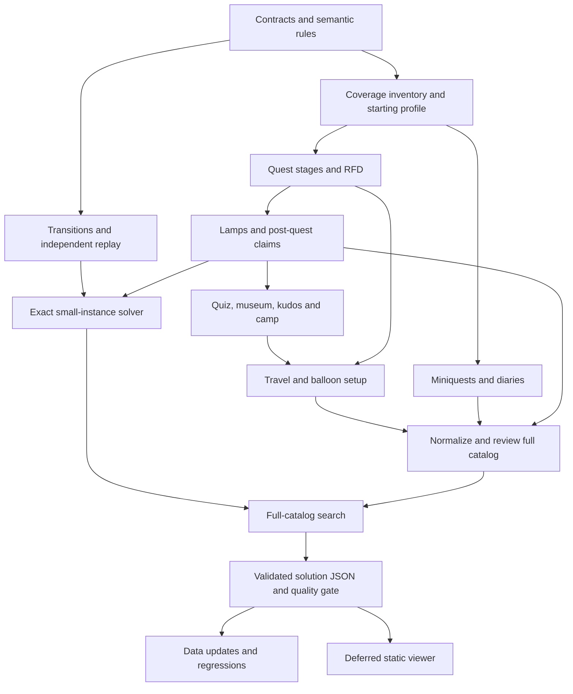

# Implementation roadmap

Tracking issue: [#1 — Offline quest-order optimizer, then static guide](https://github.com/KihiraLove/osrs-optimal-quest-guide/issues/1).

This scaffold provides the repository split, design decisions, draft JSON schemas,
an offline structural validator, synthetic contract examples and CI. It does not
provide real game data or an optimizer result. The issues below carry the remaining
implementation work, dependencies and acceptance criteria.

| Issue | Phase | Depends on |
| --- | --- | --- |
| [#2 — Harden JSON contracts and implement semantic validation](https://github.com/KihiraLove/osrs-optimal-quest-guide/issues/2) | Foundation | Scaffold |
| [#3 — Inventory game content, provenance and the initial main-account profile](https://github.com/KihiraLove/osrs-optimal-quest-guide/issues/3) | Data baseline | #2 |
| [#4 — Gather quest stages, requirements and rewards; split Recipe for Disaster](https://github.com/KihiraLove/osrs-optimal-quest-guide/issues/4) | Data collection | #2, #3 |
| [#5 — Catalog lamps, reward choices and separately claimed post-quest XP](https://github.com/KihiraLove/osrs-optimal-quest-guide/issues/5) | Data collection | #2, #3, #4 |
| [#6 — Gather miniquests and achievement diary tasks, tiers and claims](https://github.com/KihiraLove/osrs-optimal-quest-guide/issues/6) | Data collection | #2, #3 |
| [#7 — Model the Natural History Quiz, museum kudos, rewards and camp unlocks](https://github.com/KihiraLove/osrs-optimal-quest-guide/issues/7) | Data collection | #2, #3, #5 |
| [#8 — Build a state-dependent travel graph and balloon route unlocks](https://github.com/KihiraLove/osrs-optimal-quest-guide/issues/8) | Data collection | #2, #3, #4, #7 |
| [#9 — Implement offline normalisation, conflict review and catalog coverage checks](https://github.com/KihiraLove/osrs-optimal-quest-guide/issues/9) | Data quality | #2, #3, #4, #5, #6, #7, #8 |
| [#10 — Implement action transitions and independent route replay](https://github.com/KihiraLove/osrs-optimal-quest-guide/issues/10) | Optimizer foundation | #2 |
| [#11 — Build exact small-instance search and XP-only optimisation benchmarks](https://github.com/KihiraLove/osrs-optimal-quest-guide/issues/11) | Optimizer | #10, #5 |
| [#12 — Scale reward-aware and travel-aware search to the full quest catalog](https://github.com/KihiraLove/osrs-optimal-quest-guide/issues/12) | Optimizer | #11, #9, #8 |
| [#13 — Export reproducible solution JSON and pass the optimizer release gate](https://github.com/KihiraLove/osrs-optimal-quest-guide/issues/13) | Release | #12, #10, #9 |
| [#14 — Maintain catalog revisions, provenance and optimizer regressions](https://github.com/KihiraLove/osrs-optimal-quest-guide/issues/14) | Maintenance | #9, #13 |
| [#15 — Deferred: build GitHub Pages viewer using kihiras-tools-common](https://github.com/KihiraLove/osrs-optimal-quest-guide/issues/15) | Deferred frontend | #13 |

## Delivery order

Data collection can proceed in separate reviewed batches once the contract and
source inventory are stable. The transition engine and tiny exact benchmarks can
use synthetic fixtures while acquisition continues. No frontend implementation
starts before #13's full-route acceptance gate passes.

## Decisions that every issue must preserve

- Minimise manual XP amounts, not estimated training time. Leave methods to the player.
- Use non-training activity/travel time only as the secondary objective.
- All game facts and model inputs are committed JSON; neither app fetches Wiki data.
- Trade-enabled main accounts still obey untradeable-item and unlock restrictions.
- Keep quest-lamp any-skill policy distinct from recorded observed eligibility.
- Never mistake schema validity for gameplay validity, completeness or an optimality proof.

See [scope](scope.md), [data model](data-model.md), [acquisition and cleaning](data-pipeline.md),
[optimizer design](optimizer-design.md) and [verification gates](validation.md).
